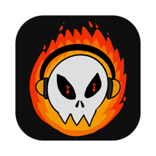
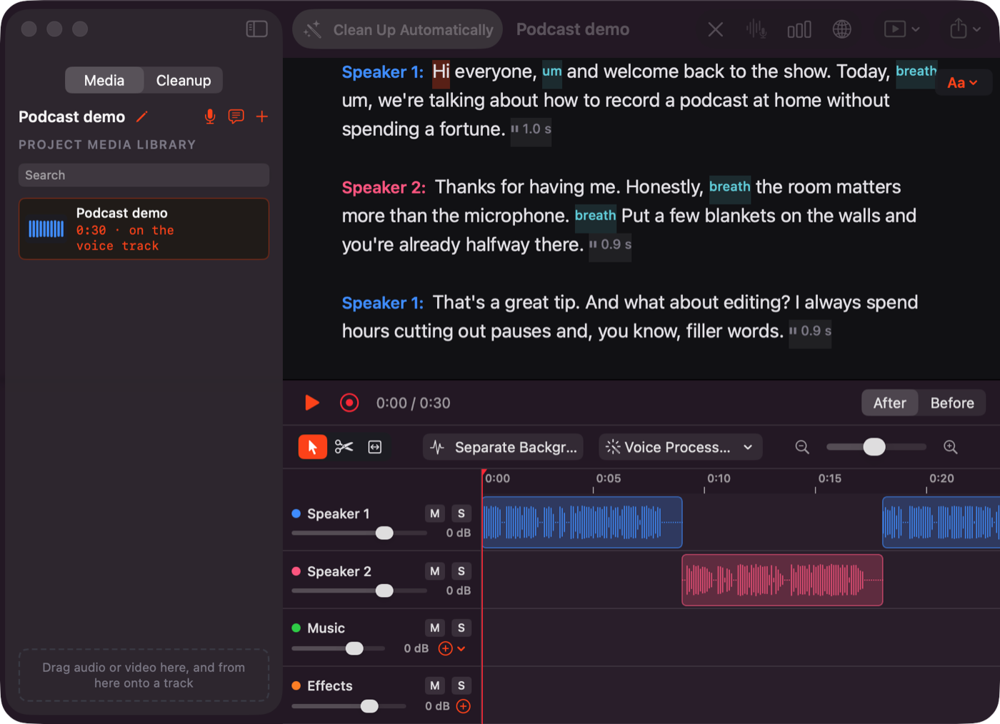
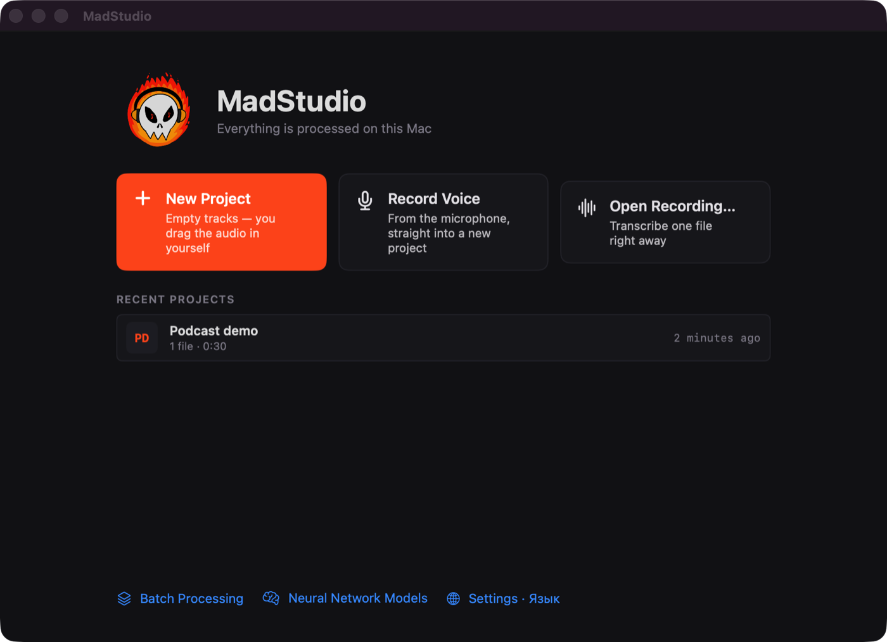
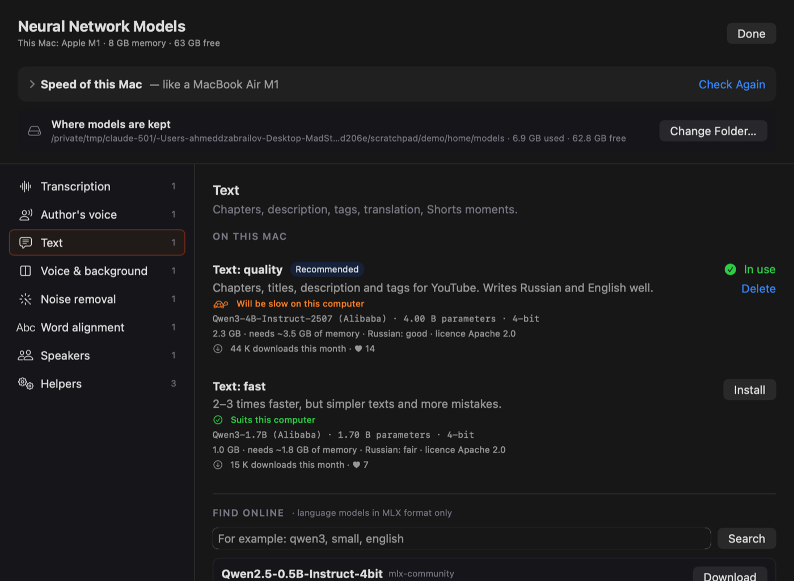

<p align="center"></p>

<h1 align="center">MadStudio</h1>

<p align="center"><b>A free, local alternative to Descript — an AI audio editor for podcasters and video creators.</b><br>
Edit speech as text, clean up “um”s and pauses, fix slips in your own voice —<br>
everything runs on your Mac. No cloud, no subscription.</p>

<p align="center"><a href="#русский">Русский ↓</a></p>



## What it does

- **Edit by text.** The recording becomes a document with the timing of every word. Delete a word and the sound is cut; click a word to put the cursor there, Space to listen. Find any word or phrase (⌘F) and cut every occurrence at once; fix a misheard word without touching the sound.
- **Clean up automatically.** Long pauses, breaths, “um”s, clicks, filler words and failed takes are found and removed in one click, with a before/after comparison. Nothing is destroyed: every edit can be undone.
- **Fix slips in the speaker's own voice.** Select words, type what should have been said, and the phrase is re-voiced in the same voice, with the room sound of the recording around it. Generated pieces are marked purple and carry an inaudible AI watermark.
- **Consent first.** A voice is used only after its owner reads a random check phrase aloud — the program checks both the words and the voice. Guests' voices need their consent.
- **Speakers and tracks.** Speakers are recognised automatically and each gets a track — and one click makes them equally loud. A multitrack timeline with arrow, blade and range tools, music ducked under speech, effects, trackpad zoom.
- **Voice processing.** Noise removal, a “radio voice”, background separation (voice vs. music), microphone presets with automatic setup for your voice.
- **For YouTube and Shorts.** Chapters with timecodes, titles, description and tags, and the best moments for Shorts — saved as ready 9:16 videos with word-by-word captions. All written by a language model on your Mac.
- **Export.** MP3/WAV with loudness presets (YouTube −14, podcast −16, radio −23 LUFS), SRT/VTT subtitles that follow the edit, text with or without timecodes.
- **Translation in the speaker's voice** (experimental): the edited recording is translated phrase by phrase and spoken in the original voice over the original background.
- **Models like in LM Studio.** Choose, download and update neural networks per task, search Hugging Face within the family the program can run, see whether a model suits your Mac.

Interface in **English** and **Russian** (Settings → Interface language). Transcription works in many languages; Russian and English are the most tested.

<p align="center"> </p>

## Download

Get the latest `.dmg` from **[Releases](../../releases)**, open it and drag MadStudio into Applications.

**Requirements:** a Mac with an Apple chip (M1 or newer) and macOS 15 or newer. 8 GB of memory is enough; more makes the heavy steps faster. The app is ~2 GB; neural networks are downloaded on first use (about 1–7 GB depending on what you use).

**First launch.** The app isn't signed with a paid Apple Developer certificate yet, so macOS will say it can't verify it. Click **Done**, then open **System Settings → Privacy & Security**, scroll down to “MadStudio was blocked…” and click **Open Anyway**. You only need to do this once.

## Privacy

Recordings, transcripts and edits never leave your Mac. The internet is used only to download models from Hugging Face when you ask for them.

## Models and licences

MadStudio's own code is licensed under the **GNU GPL v3** (see [LICENSE](LICENSE)). The neural networks are downloaded separately and keep their own licences, shown in the Models window:

| Task | Model | Licence |
|---|---|---|
| Transcription | Whisper large-v3-turbo (MLX) | MIT |
| Word alignment (Russian) | wav2vec2-large-xlsr-53-russian | Apache 2.0 |
| Speakers | SpeechBrain ECAPA | Apache 2.0 |
| Voice | F5-TTS (Russian fine-tune) | **CC BY-NC 4.0 — non-commercial only** |
| Text (chapters, Shorts, translation) | Qwen3 (MLX) | Apache 2.0 |
| Background separation | HTDemucs v4 | MIT |
| Noise removal | DeepFilterNet 3 | MIT / Apache 2.0 |
| AI watermark | AudioSeal | MIT |

The app bundles its own Python, libraries and an LGPL build of FFmpeg; the full list is in `THIRD-PARTY-LICENSES.txt` inside the app.

## Building from source

You need Xcode, [XcodeGen](https://github.com/yonaskolb/XcodeGen), [uv](https://github.com/astral-sh/uv) and FFmpeg (`brew install xcodegen uv ffmpeg`).

```bash
cd engine && uv sync          # the neural network engine (Python 3.12)
uv run pytest                 # engine tests
cd ../app && ./build.sh       # builds MadStudio.app into the project folder
```

A self-contained release (own Python, engine and FFmpeg inside, `.dmg`): `release/build-release.sh`.

- `app/` — the SwiftUI app (interface, editing model, timeline, player)
- `engine/` — the Python engine (MLX / PyTorch): transcription, cleanup markers, voice, translation, models library; the app talks to it through JSON lines
- `release/` — scripts for the self-contained build

## Status

Early beta, developed and tested on a MacBook Air M1 with 8 GB. Planned: a Windows version, export to DaVinci Resolve / Final Cut, a live mode for streams. Bug reports and ideas are welcome in [Issues](../../issues).

---

<a id="русский"></a>

## Русский

**MadStudio** — бесплатная локальная альтернатива Descript: ИИ-аудиоредактор для подкастеров и блогеров. Всё работает на вашем Mac: без облака и подписок.

- **Монтаж по тексту:** запись превращается в документ, удалили слово — вырезался звук. Поиск ⌘F с «Вырезать все», исправление ослышанных слов без изменения звука.
- **Чистка в один клик:** паузы, вдохи, «э-э», щелчки, слова-паразиты, неудачные дубли; сравнение «до/после», всё можно вернуть.
- **Исправление оговорок голосом автора:** выделите слова, напечатайте, как надо, — фраза переозвучится тем же голосом. Сгенерированное помечается фиолетовым и незаметной меткой ИИ.
- **Только с согласия:** голос используется после того, как его владелец прочитает проверочную фразу.
- **Спикеры и дорожки:** собеседники определяются сами, громкость выравнивается одной кнопкой, многодорожечный монтаж, музыка приглушается под речью.
- **Обработка голоса:** шумоподавление, «радиоголос», отделение голоса от музыки, пресеты микрофона с автонастройкой.
- **Для YouTube и Shorts:** главы, названия, описание, теги и лучшие моменты — сразу готовыми вертикальными видео с субтитрами.
- **Экспорт:** MP3/WAV с пресетами громкости, субтитры SRT/VTT, текст.
- **Перевод голосом автора** (эксперимент).

Интерфейс на русском и английском (Настройки → Язык интерфейса).

**Скачать:** `.dmg` в разделе **[Releases](../../releases)**. Нужен Mac на чипе Apple (M1 и новее), macOS 15+. При первом открытии macOS предупредит, что не может проверить программу: «Готово» → Системные настройки → Конфиденциальность и безопасность → «Всё равно открыть». Один раз.

Код — под лицензией **GNU GPL v3**. Голосовая модель F5-TTS (русская) — только для некоммерческого использования.
